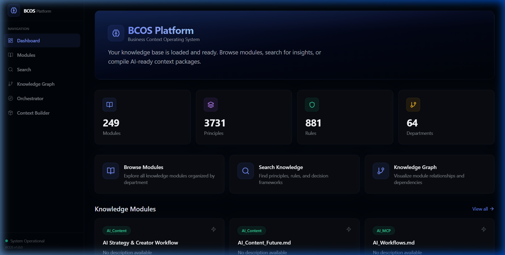
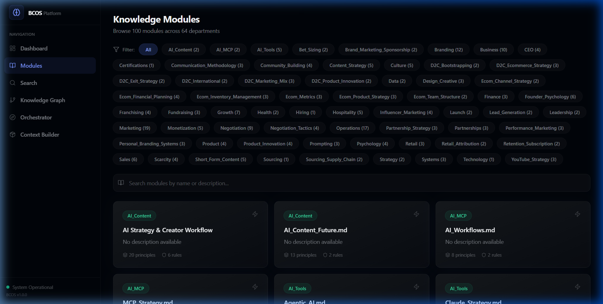
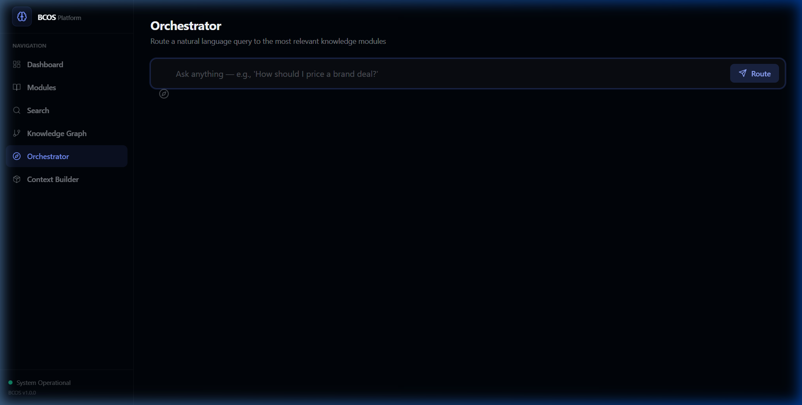
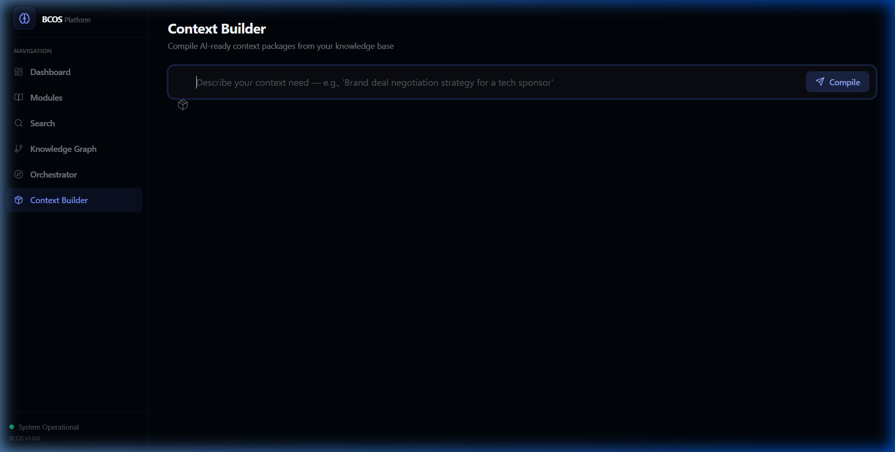
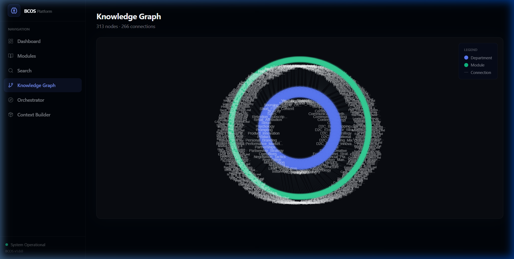

# BCOS Platform

**Business Context Operating System – Platform**

> A full‑stack application for serving business intelligence from structured knowledge modules.
> Consumed by humans, AI agents, and APIs.

---

## Overview

The BCOS Platform turns a folder of Markdown files (the BCOS knowledge base) into a production‑ready API, web portal, knowledge graph, and semantic search engine. It provides:

- **Context‑Aware API** – Route questions to the right modules, compile AI‑ready context.
- **Knowledge Graph** – Visualise relationships between departments, modules, and concepts.
- **Semantic Search** – Find relevant principles, rules, and frameworks using vector search.
- **Premium Web Portal** – Browse, search, and explore the knowledge base with a dark‑theme UI.
- **MCP Integration** – Expose knowledge as tools for AI agents (Claude, custom agents).

---

## 📸 Screenshots & UI Gallery

### Enterprise Dashboard & Knowledge Graph


| Page | URL | Visual Preview |
|---|---|---|
| **Knowledge Directory** | `/modules` |  |
| **Context Orchestrator** | `/orchestrator` |  |
| **AI Context Builder** | `/context` |  |
| **Knowledge Graph** | `/graph` |  |

> 🎨 For complete design specifications, typography tokens, and color systems, see the [UI/UX System Document](docs/UI_UX_SYSTEM.md).

---

## Quick Start

### Prerequisites

- Docker & Docker Compose
- Make (optional, for convenience)
- Node.js 18+ (for frontend development without Docker)

### 1. Clone the Repository

```bash
git clone https://github.com/your-org/bcos-platform.git
cd bcos-platform
```

### 2. Copy Your Knowledge Base

Place your BCOS Markdown files into `data/business_context/`. The directory should contain the standard structure:

```
data/business_context/
├── Orchestrator.md
├── Marketing/
├── Business/
├── CEO/
├── Technology/
└── ... (other departments)
```

### 3. Configure Environment

```bash
cp .env.example .env
```

Edit `.env` if needed (default values work for local development).

### 4. Run with Docker Compose

```bash
make dev
# or
docker-compose up -d
```

This will start:

| Service | Port |
|---------|------|
| PostgreSQL | 5432 |
| Redis | 6379 |
| Neo4j | 7474 / 7687 |
| Backend API | 8000 |
| Frontend Portal | 3000 |

### 5. Load the Knowledge

After the services are running, load the knowledge base:

```bash
make load-data
# or
docker-compose exec backend python scripts/load_knowledge.py
```

### 6. Open the Portal

- **Portal:** http://localhost:3000
- **API Docs:** http://localhost:8000/api/docs

---

## Architecture

```
┌──────────────────────────────────────────────────────────────┐
│                       Presentation Layer                     │
│  Next.js Portal   │   MCP Server   │   REST API (FastAPI)   │
└────────────────────────────┬─────────────────────────────────┘
                             │
┌────────────────────────────▼─────────────────────────────────┐
│                    Orchestration Layer                        │
│   Context Router   │   Context Compiler   │   Search Engine  │
└────────────────────────────┬─────────────────────────────────┘
                             │
┌────────────────────────────▼─────────────────────────────────┐
│                     Knowledge Layer                          │
│   PostgreSQL     │    Neo4j     │    Chroma (Vector DB)      │
│  (modules,       │  (graph of   │  (semantic embeddings)     │
│   principles,    │   relations) │                             │
│   rules, trees)  │              │                             │
└────────────────────────────┬─────────────────────────────────┘
                             │
┌────────────────────────────▼─────────────────────────────────┐
│                      Data Layer                              │
│   Markdown files (data/business_context/ – source of truth)  │
└──────────────────────────────────────────────────────────────┘
```

## Key Services

| Service | Description |
|---------|-------------|
| **Knowledge Loader** | Parses Markdown files, extracts structured data, stores in PostgreSQL. |
| **Orchestrator** | Matches natural‑language queries to modules using `Orchestrator.md`. |
| **Context Compiler** | Builds AI‑ready context packages (Markdown/JSON) from selected modules. |
| **Vector Store** | Semantic search via Chroma embeddings. |
| **Graph Store** | Neo4j knowledge graph for relationship queries and visualisation. |
| **MCP Server** | Exposes BCOS tools/resources for AI agents. |

---

## Development

### Backend (FastAPI)

```bash
cd backend
pip install -e ".[dev]"
uvicorn src.main:app --reload --port 8000
```

### Frontend (Next.js)

```bash
cd frontend
npm install
npm run dev
```

### Running Tests

```bash
make test
# or
cd backend && python -m pytest
cd frontend && npm test
```

---

## Deployment

### Staging / Production

Use the provided Kubernetes manifests in `k8s/` for production deployments. See [DEPLOYMENT.md](docs/DEPLOYMENT.md).

### Docker Images

```bash
make build
```

---

## Contributing

See [CONTRIBUTING.md](docs/CONTRIBUTING.md).

---

## License

Proprietary / Internal Use Only. See [LICENSE](LICENSE).

---

## Acknowledgements

Built with ❤️ using FastAPI, Next.js, PostgreSQL, Neo4j, Chroma, and Tailwind CSS.

**Version:** 1.0.0
