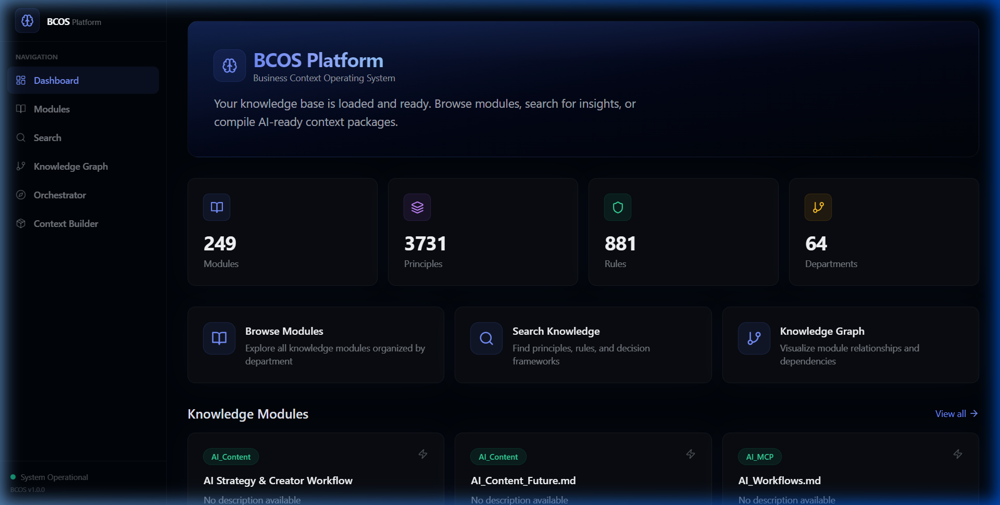
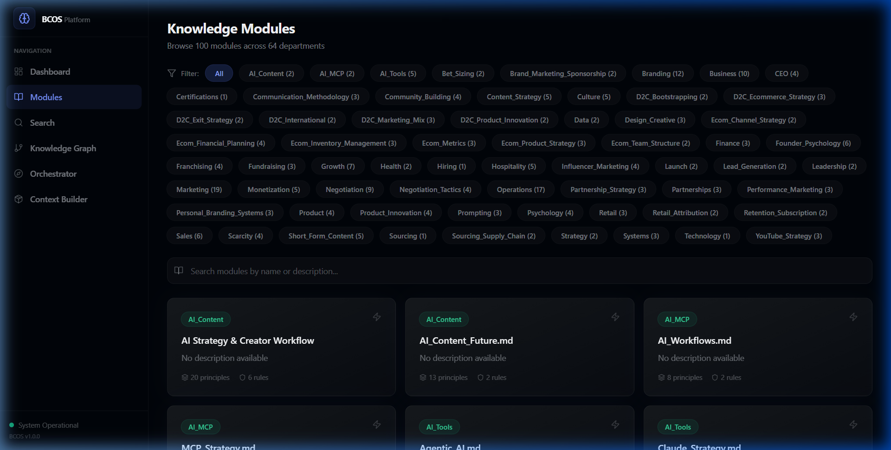
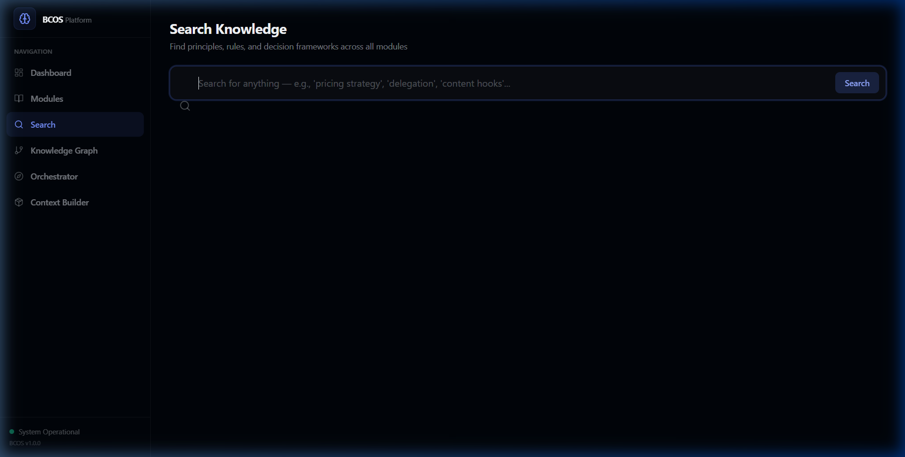
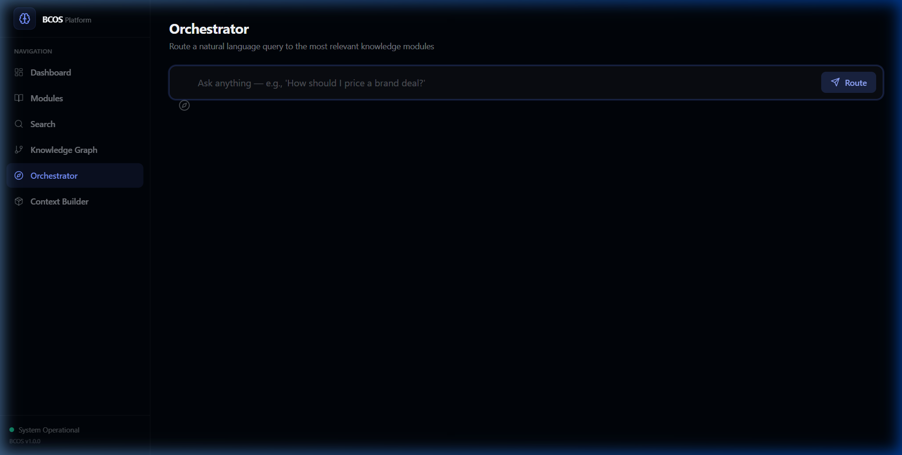
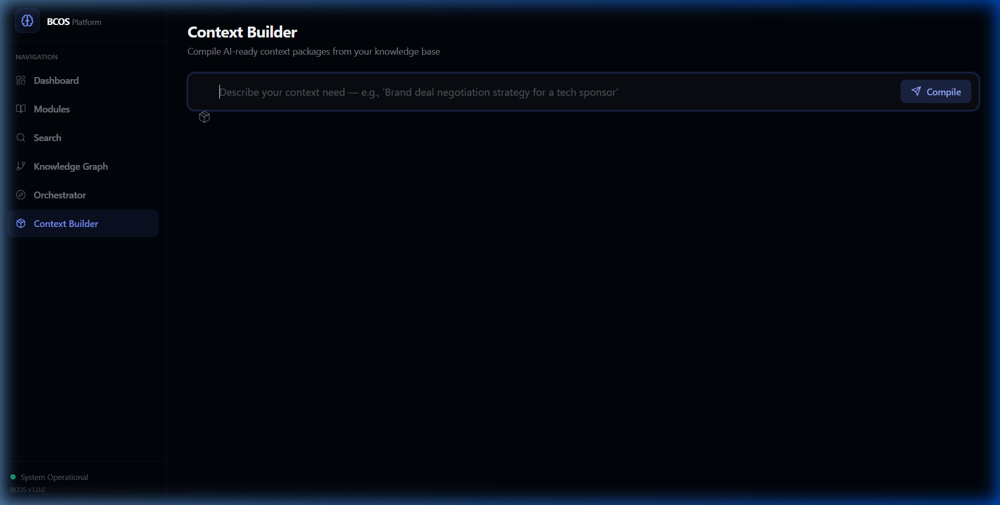
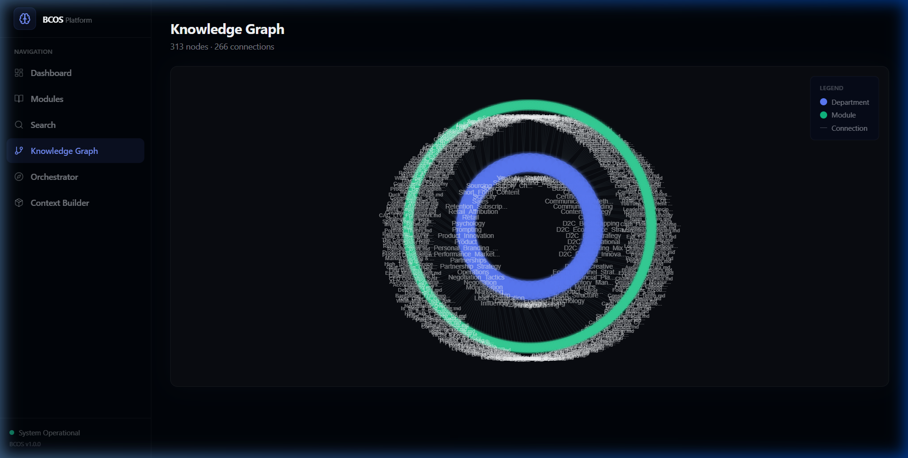

# BCOS Platform — UI/UX Design System & Screen Gallery

**Version:** 1.0.0  
**Target Audience:** Frontend Engineers, UI/UX Designers, Product Managers  
**Guiding Design Principle:** The BCOS UI/UX is built to provide an ultra-premium, dark-mode-first, high-density enterprise intelligence interface. Every pixel emphasizes speed, visual clarity, glassmorphic aesthetics, and effortless navigation across 249+ business context modules.

---

## 🖼️ Application Screen Gallery

Below are live screenshots capturing the core views of the BCOS Platform web application:

### 1. Enterprise Intelligence Dashboard
The main command center showcasing realtime stats (249 Modules, 3,731 Principles, 881 Rules, 64 Departments), system operational status, and high-frequency knowledge module cards with department badges.

---

### 2. Knowledge Module Directory & Browser (`/modules`)
A filterable, searchable directory listing all 249 business context modules across 64 departments with live search filters, principle counters, and rule indicators.

---

### 3. RAG Semantic & Full-Text Search (`/search`)
Fast semantic vector search powered by ChromaDB (`all-MiniLM-L6-v2` embeddings) and full-text keyword indexing across all 3,731 principles and 881 operational rules.

---

### 4. Dynamic Context Orchestrator (`/orchestrator`)
The visual query routing engine that matches user queries against the master `Orchestrator.md` routing table and identifies required context modules with relevance scores.

---

### 5. AI Context Compiler & Exporter (`/context`)
A self-service workspace allowing AI engineers to select specific business context modules and compile them into a unified, formatted Markdown payload ready for LLM system prompts.

---

### 6. Interactive Neo4j Knowledge Graph (`/graph`)
A 2D/3D canvas force-directed graph renderer visualizing 313 nodes and 266 directional cross-reference links connecting business departments, modules, and principles.

---

## 🎨 Design Philosophy & Principles

### 1. High-Density Enterprise Intelligence
Business leaders and AI engineers need instant access to principles, rules, and decision frameworks. The layout avoids unnecessary fluff, using tight vertical rhythm and clean grid systems to maximize data density without visual clutter.

### 2. Dark-Mode-First & Glassmorphism
The interface uses deep space backdrops (`#020617` Slate-950) with frosted glass container overlays (`bg-white/[0.03] backdrop-blur-xl border-white/5`), dynamic ambient radial glows, and electric indigo highlights (`#5c7cfa`).

### 3. Immediate Visual Differentiation
Operational content is categorized visually:
- **Principles:** Icon-anchored cards with distinct numbering and source quotes.
- **Typed Rules:** Color-coded border indicators (Emerald for *Always*, Red for *Never*, Amber for *Avoid*, Blue for *Prefer*).
- **Decision Trees:** Step-by-step logic flows with condition/action branching cards.
- **Departments:** Color-coded department pill badges.

---

## 📐 Color Palette & Token System

### Base Surface Palette (Slate Dark Scale)
| Token | Hex / Value | Usage |
|---|---|---|
| `--bg-primary` / `surface-900` | `#020617` | Main viewport backdrop |
| `--bg-secondary` / `surface-800` | `#0f172a` | Sidebar, cards, popovers, headers |
| `--bg-tertiary` / `surface-700` | `#1e293b` | Borders, subtle dividers, hover backdrops |
| `--border-color` | `#1e293b` | Primary container borders |

### Brand Accent Palette (Electric Indigo)
| Token | Hex / Value | Usage |
|---|---|---|
| `brand-300` | `#91a7ff` | Subtle text highlights, active state gradients |
| `brand-400` | `#748ffc` | Secondary button text, icons |
| `brand-500` / `--accent` | `#5c7cfa` | Primary buttons, active indicators, interactive elements |
| `brand-600` | `#4c6ef5` | Button hover states |
| `brand-700` | `#4263eb` | Active focus rings |
| `--accent-glow` | `rgba(92, 124, 250, 0.15)` | Dynamic card hover glow & radial spotlight |

### Semantic System Colors
| Context | Color / Class | Border Indicator | Usage |
|---|---|---|---|
| **Always (Rule)** | `#34d399` Emerald | `border-l-2 border-emerald-500` | Mandatory operational directives |
| **Never (Rule)** | `#f87171` Red | `border-l-2 border-red-500` | Prohibited actions & anti-patterns |
| **Avoid (Rule)** | `#fbbf24` Amber | `border-l-2 border-amber-500` | Cautionary guidelines & friction risks |
| **Prefer (Rule)** | `#60a5fa` Blue | `border-l-2 border-blue-500` | Recommended default practices |

---

## 🔤 Typography & Font Hierarchy

The BCOS Platform utilizes **Inter** for clean UI readability and **JetBrains Mono** for code snippets, JSON payloads, and system prompt compilations.

### Font Scale
| Element | Font Family | Weight | Size / Line Height | Tailwind Class |
|---|---|---|---|---|
| **Hero Heading** | Inter | 800 (ExtraBold) | 2.25rem / 2.5rem | `text-4xl font-extrabold tracking-tight` |
| **Section Title** | Inter | 700 (Bold) | 1.5rem / 2rem | `text-2xl font-bold` |
| **Card Title** | Inter | 600 (SemiBold) | 1.125rem / 1.75rem | `text-lg font-semibold` |
| **Body Text** | Inter | 400 (Regular) | 0.875rem / 1.25rem | `text-sm text-slate-300` |
| **Muted Text** | Inter | 400 (Regular) | 0.75rem / 1rem | `text-xs text-slate-500` |
| **Code & Markdown** | JetBrains Mono | 500 (Medium) | 0.8125rem / 1.25rem | `font-mono text-xs text-slate-200` |

---

## 📱 Layout Grid & Responsive Breakpoints

| Device Class | Breakpoint | Column Layout | Sidebar Behavior |
|---|---|---|---|
| **Mobile** | `< 640px` | 1 Column | Collapsed into drawer menu |
| **Tablet** | `640px – 1024px` | 2 Columns | Icon-only collapsible rail |
| **Desktop** | `1024px – 1536px` | 3 Columns | Fixed 256px sidebar |
| **Ultra-Wide** | `> 1536px` | 4 Columns | Fixed 280px sidebar with extended context preview |
